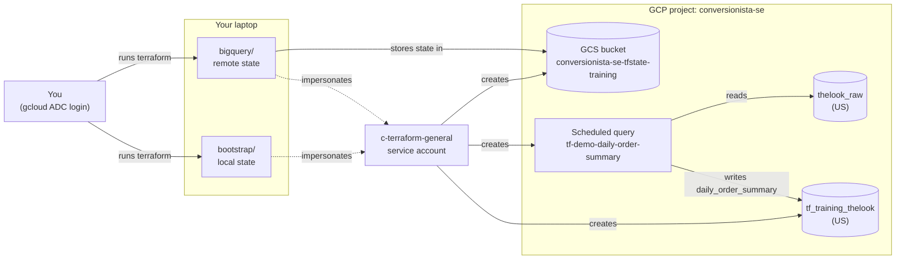
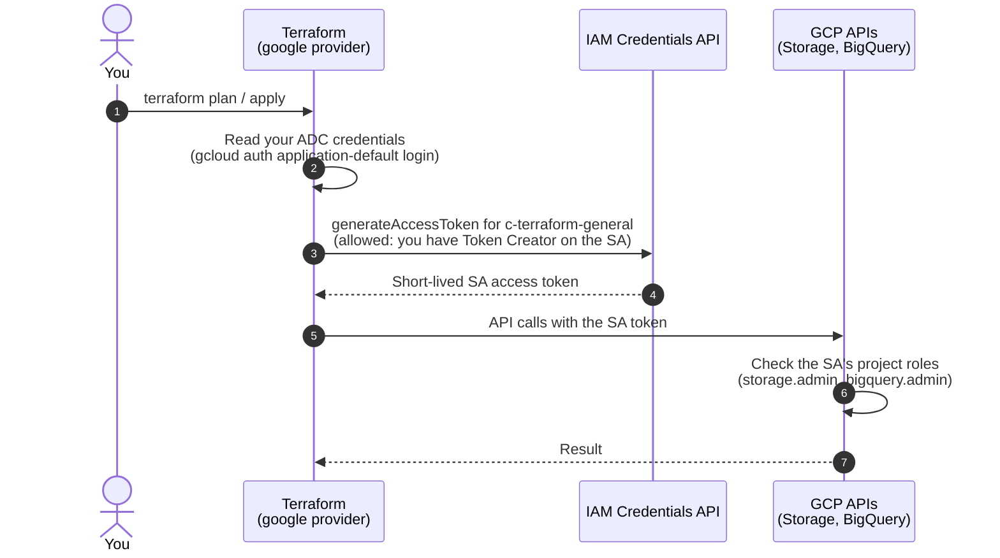
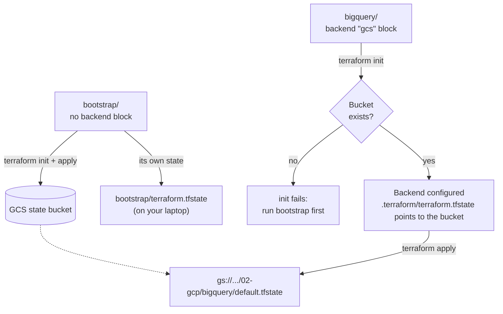
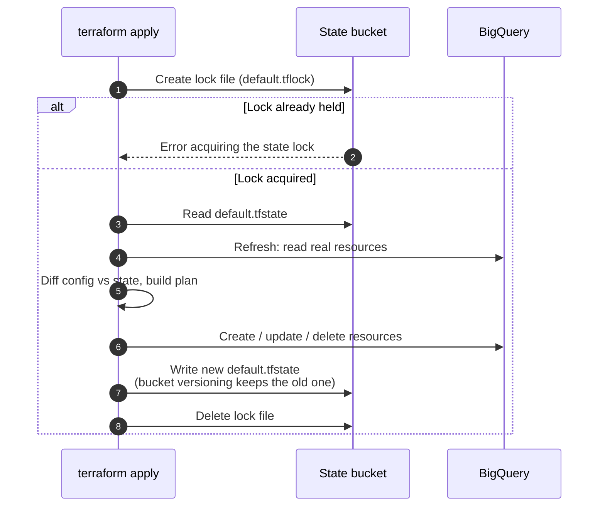
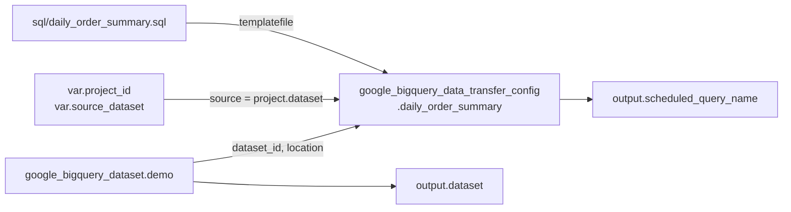
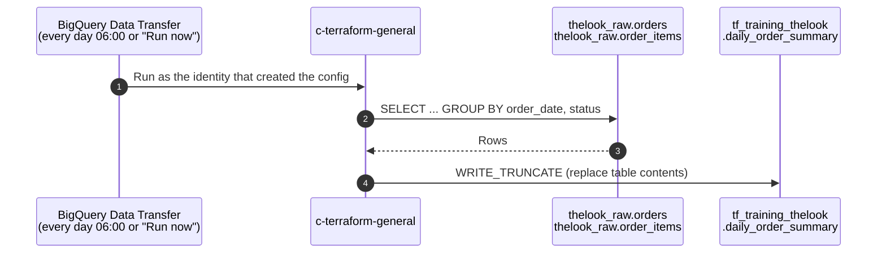
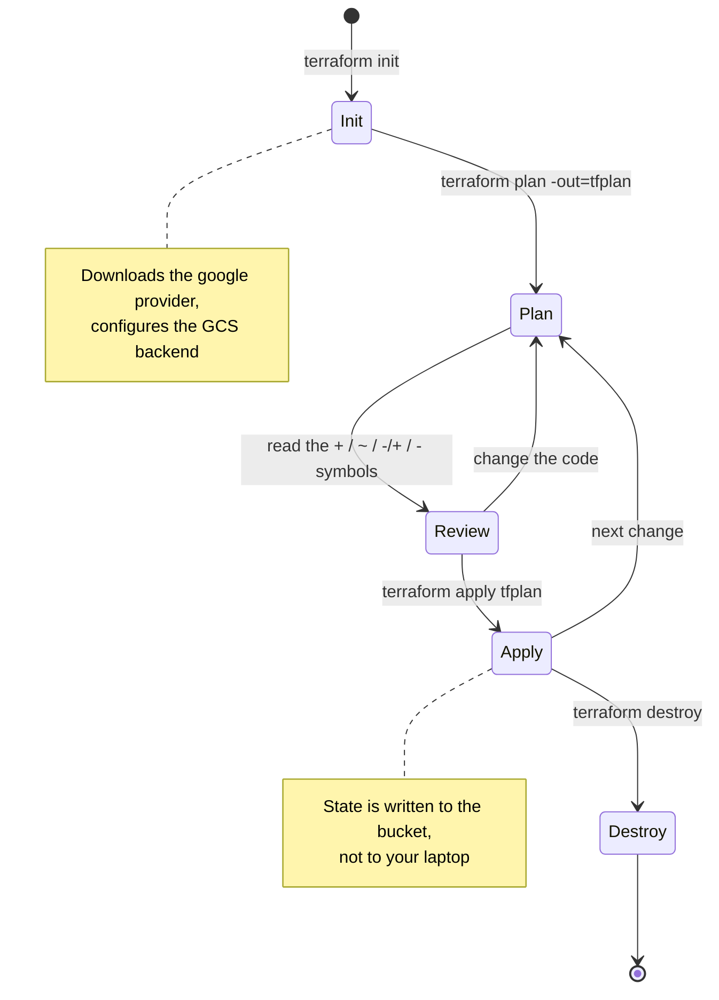
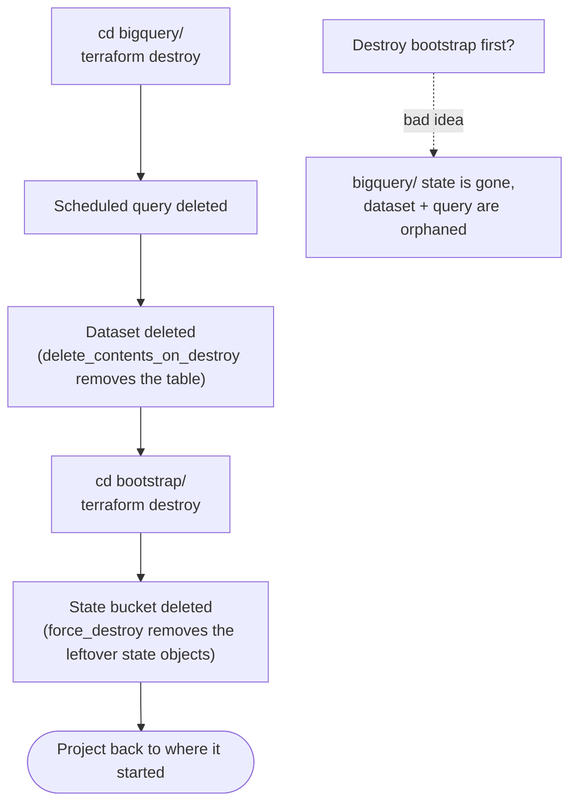

# Part 02: how the Terraform flow works on GCP

## The big picture

Two Terraform configurations, one service account, one project.



## Step 1–2: authentication and impersonation

You log in as yourself, but every API call is made as the service account.



Two things have to be true:

| Permission | Granted to | On |
|---|---|---|
| `roles/iam.serviceAccountTokenCreator` | You | The service account |
| `roles/storage.admin`, `roles/bigquery.admin` | The service account | The project |

## Step 3: bootstrapping remote state

The chicken-and-egg problem: remote state needs a bucket, and the bucket is created by Terraform.



How the GCS backend handles each run:



## Step 4–5: dependency graph

Terraform works out the order from references. Nothing needs `depends_on`.



So `apply` creates the **dataset first**, then the scheduled query. `destroy` runs in reverse.

You can generate this graph yourself:

```bash
terraform graph | dot -Tsvg > graph.svg    # needs graphviz
```

## What the scheduled query does once created

Terraform only creates the *definition*. BigQuery runs it on the schedule.



Terraform isn't involved in the runs. Data written by the query isn't in Terraform state.

## The command lifecycle

The same loop as Part 01, now against real cloud resources.



## Step 6: teardown order

Destroy in the **reverse** order of creation. The bucket holds the state for `bigquery/`, so it goes last.



## Cheat sheet

| Command | Run in | What it does here |
|---|---|---|
| `gcloud auth application-default login` | anywhere | Your credentials, used to impersonate the SA |
| `terraform init` | `bootstrap/`, `bigquery/` | Download the provider; in `bigquery/`, connect to the GCS backend |
| `terraform plan -out=tfplan` | both | Preview, impersonating the SA |
| `terraform apply tfplan` | both | Create the bucket / dataset + scheduled query |
| `terraform state list` | `bigquery/` | Reads state **from the bucket** |
| `gcloud storage ls -r gs://conversionista-se-tfstate-training` | anywhere | See the state file and lock |
| `terraform destroy` | `bigquery/` then `bootstrap/` | Tear down in reverse order |
