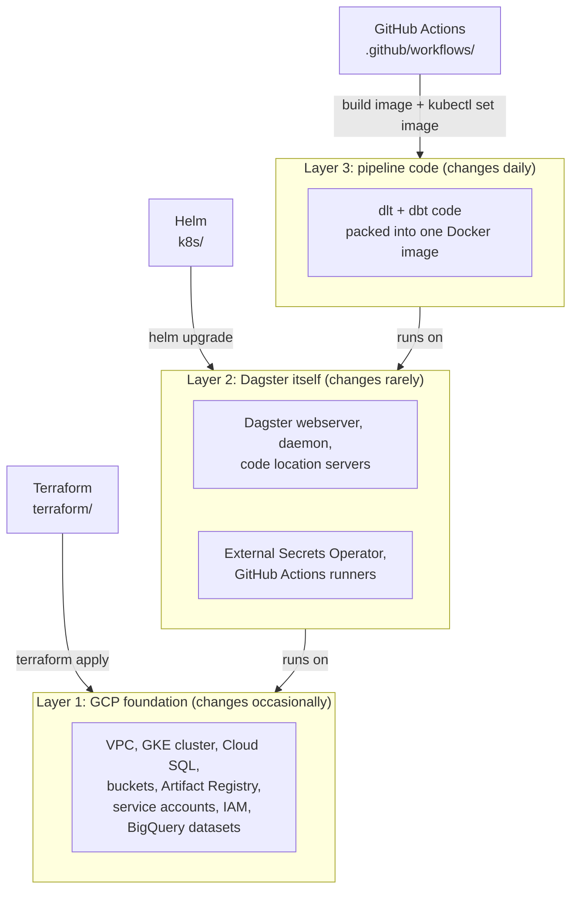
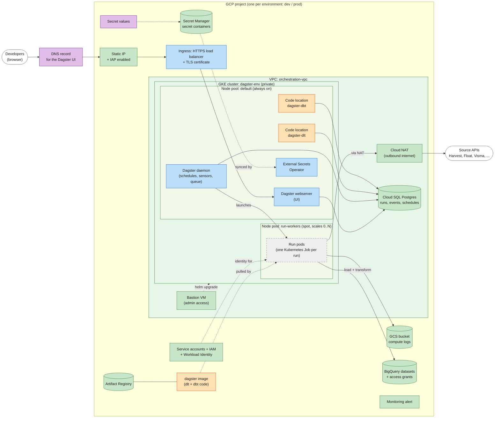
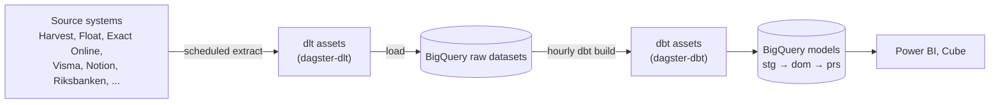
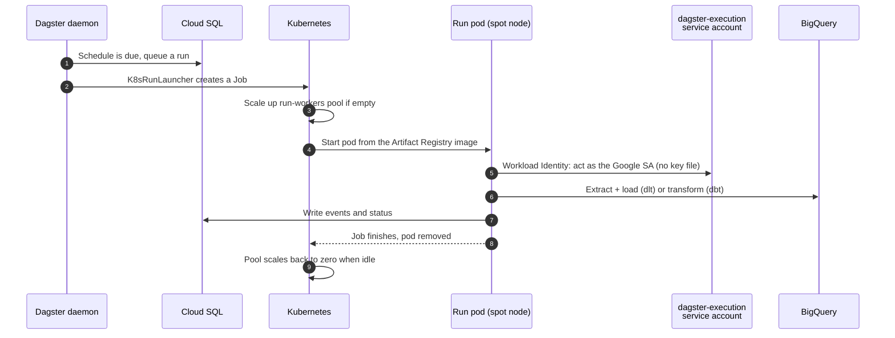
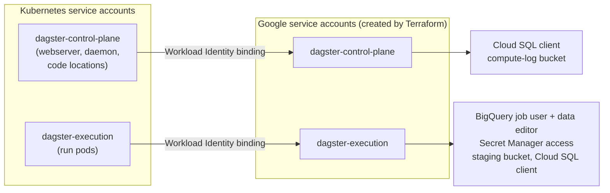
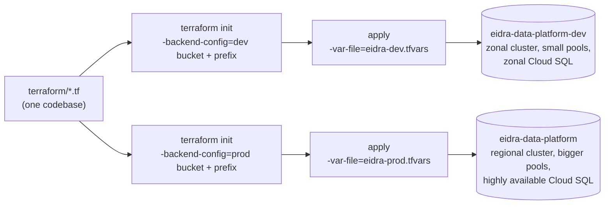
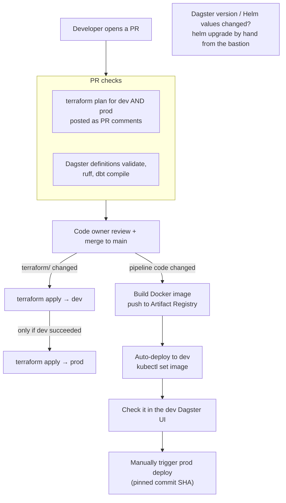

# Part 03: How Terraform builds the Dagster platform

Parts 01 and 02 covered Terraform basics and a small GCP setup. Part 03 is a high-level tour of a real platform: the **Eidra Data Platform** monorepo, where Dagster is self-hosted on Google Kubernetes Engine (GKE) and Terraform builds the cloud infrastructure it runs on.

There's nothing to run here. It's an architecture overview with notes on where Terraform fits in.

## The one-sentence version

> **Terraform builds the GCP foundation** (network, Kubernetes cluster, database, buckets, service accounts, permissions), **Helm installs Dagster on top of it**, and **GitHub Actions ships the pipeline code** as Docker images.

## Quick glossary

| Term | In plain words |
|---|---|
| **Dagster** | The orchestrator. It decides *what* runs *when* (schedules), tracks every run, and shows lineage between data assets. |
| **dlt** | Python library that pulls data from source APIs (Harvest, Float, Visma, …) and loads it into BigQuery. |
| **dbt** | Transforms raw BigQuery tables into clean models with SQL (`stg` → `dom` → `prs`). |
| **GKE** | Google's managed Kubernetes, where Dagster's containers run. |
| **Helm** | A package manager for Kubernetes. The official Dagster Helm chart installs Dagster into the cluster. |
| **Code location** | A Dagster process that serves a set of pipelines. Here there are two: one for dlt, one for dbt. |
| **Workload Identity** | Lets a Kubernetes pod act as a Google service account without any key files. |

## 1. Who builds what

Three tools each own one layer. This split is the most important idea in this part.

**Why doesn't Terraform install Dagster too?** It could, using the Helm or Kubernetes providers, but the cluster's control plane is **private**. Terraform running in CI would need a network path into the cluster and Kubernetes admin rights. The team chose to keep Terraform at the GCP level and install the in-cluster software with Helm from a bastion VM, a small admin machine inside the network. Terraform creates that bastion too.

### The components Terraform builds

1. **Network:** a private VPC, Cloud NAT for outbound internet access, and a private connection to Cloud SQL.
2. **Kubernetes cluster:** a private GKE cluster with two node pools: an always-on pool for Dagster itself, and a spot pool that scales from zero for pipeline runs.
3. **Database:** Cloud SQL Postgres, where Dagster stores run history, event logs and schedule state.
4. **Storage:** GCS buckets for Dagster's compute logs, dlt staging and BigQuery backups.
5. **Image registry:** Artifact Registry, which holds the Docker image with the pipeline code.
6. **Identity and access:**
   - service accounts for Dagster's control plane and its run pods
   - the IAM roles for those accounts
   - Workload Identity bindings that let pods act as those accounts
   - the GitHub OIDC pool for CI
   - project IAM for user groups
7. **Secrets:** the Secret Manager *containers* for API keys and the database password. The values are added outside Terraform.
8. **BigQuery:** datasets, access grants, scheduled transfers and an audit-log sink.

Supporting pieces: a static IP and Identity-Aware Proxy (IAP) for the Dagster UI, a bastion VM for admin access, and a monitoring alert for when the Dagster stack goes missing.

**Not built by Terraform:** anything *inside* the cluster (Dagster, External Secrets Operator, GitHub Actions runners, the Ingress), DNS records, secret values, and the pipeline code.

## 2. What runs where

Colours show **who manages each component**:

| Colour | Managed by |
|---|---|
| 🟩 Green | **Terraform** (`terraform/`) |
| 🟦 Blue | **Helm / kubectl**, installed into the cluster (`k8s/`) |
| 🟧 Orange | **GitHub Actions** (image build and code deploys) |
| ⬜ Grey, dashed | **Dagster at runtime** (created and removed per run) |
| 🟪 Purple | **By hand**, outside any tool (DNS record, secret values) |

The **VPC, the cluster and both node pools** (green boxes) are Terraform. The **things running inside them** are installed by Helm or deployed by CI.

The code-location servers are created by the Helm chart, but CI swaps the image they run on every code deploy, so they're marked orange.

**Notes:**

- **Two node pools save money.** Dagster's always-on parts (UI, daemon, code locations) sit on a small permanent pool. Actual pipeline runs go to a **spot** pool that scales **from zero**, so you only pay for compute while something is running.
- **Each run is its own pod.** Dagster's `K8sRunLauncher` turns every run into a Kubernetes Job. A crashing pipeline can't take down the scheduler.
- **Dagster's memory lives in Cloud SQL.** Run history, event logs and schedule state are in Postgres, so pods can restart without losing anything. Log output goes to a GCS bucket.
- **Private by default.** The cluster has no public API endpoint and the nodes have no public IPs. Outbound calls to source APIs go through Cloud NAT. The UI is only reachable through Identity-Aware Proxy (IAP) with a Google login.
- **One image, two code locations.** The same Docker image contains the dlt and the dbt code. Each code-location server just loads a different Python module from it.

## 3. How data flows

- **dlt** has one Dagster asset per source, each on its own schedule.
- **dbt** runs as a single `dbt build` job on an hourly schedule, plus a few extra jobs.
- dlt and dbt use **matching asset keys**, so Dagster draws the lineage from a source API all the way to a reporting table automatically.
- **Terraform creates the BigQuery datasets and access grants**. dlt and dbt create the tables inside them.

## 4. A single Dagster run, step by step

## 5. Identities and permissions

Dagster uses **two** Google service accounts, so the UI can't touch data and only run pods can.

Terraform creates both Google service accounts, their roles, and the Workload Identity binding that allows a specific Kubernetes service account to act as each one. It's the same idea as the impersonation you used in Part 02, but for pods instead of people.

**Secrets:** Terraform creates the *empty* secret containers in Secret Manager. Values are added by hand, outside Terraform, so they don't end up in code. The External Secrets Operator copies them into Kubernetes, and pods read them as environment variables.

## 6. What Terraform manages

All of this lives in one root module, `terraform/`, organised as **one file per concern** rather than reusable modules.

| Area | Resources | File(s) |
|---|---|---|
| Network | VPC, subnet with pod/service ranges, Cloud Router + NAT, private connection for Cloud SQL | `orchestration_vpc.tf` |
| Kubernetes | Private GKE cluster, `default` and `run-workers` node pools | `dagster_gke.tf` |
| Database | Cloud SQL Postgres 15, generated password stored in Secret Manager | `dagster_db.tf` |
| Storage | Compute-log bucket, dlt staging bucket, backup buckets | `dagster_storage.tf`, `storage.tf`, `bq_backup.tf` |
| Images | Artifact Registry `dagster-images`. Dev only, prod pulls from it across projects. | `dagster_gke.tf` |
| Identity | Service accounts, IAM roles, Workload Identity bindings, GitHub OIDC pool | `dagster_iam.tf`, `github_wif.tf` |
| Secrets | Secret Manager secret containers per source (no values) | `dagster_<source>.tf` |
| Access | Static IP for the ingress, IAP, a bastion VM for admins | `iap_ingress.tf`, `bastion.tf` |
| Monitoring | Alert if the Dagster stack goes missing | `dagster_monitoring.tf` |
| Data | BigQuery datasets, dataset/table access grants, group IAM, audit logging | `*_datasets.tf`, `prs_*_access.tf`, `iam_groups.tf`, `logging.tf` |

**Not managed by Terraform:** the Dagster Helm release and its values (`k8s/dagster/`), the Ingress manifest, DNS records, secret values, and the pipeline code itself.

## 7. Dev and prod from the same code

There are no Terraform workspaces. The same `terraform/` folder is applied twice, with different inputs:

- **`backend.tf` is empty:** `backend "gcs" {}`. The bucket and prefix are passed in at `init` time with `-backend-config`. That's the workaround for the rule from Part 02 that backend blocks can't use variables.
- **Each environment has its own project and its own state bucket**, so a mistake in dev can't touch prod's state.
- **Differences are just variables**: cluster size, regional vs zonal, backup retention. A few resources only exist in one environment, using `count = var.env == "dev" ? 1 : 0`.

## 8. How a change reaches production

Infrastructure changes and code changes take different paths.

- **The PR plan is the review gate for infrastructure.** Reviewers read the dev and prod plans in the PR comments. After merge, the apply runs automatically: first dev, then prod if dev succeeded.
- **Code is promoted, not re-built.** Prod runs exactly the image that was tested in dev, identified by its commit SHA.
- **Ordering matters.** If new pipeline code reads a new dataset, the Terraform change that grants access must be merged and applied first.

## 9. Concepts from Parts 01 and 02, at scale

| Concept you learned | How it shows up in the monorepo |
|---|---|
| Providers and version pins | `google` pinned to an exact version in `terraform/main.tf`. `google-beta`, `random` and `time` for extra features. |
| Remote state in GCS | One state bucket per project. Bucket and prefix are passed via `-backend-config`. |
| Bootstrapping state | The ML project's state bucket is created by a small shell script first: the same chicken-and-egg problem as Part 02's `bootstrap/`. |
| Variables and `.tfvars` | `eidra-dev.tfvars` / `eidra-prod.tfvars`, with a `validation` block that only allows `dev` or `prod`. |
| Outputs | Values such as the Cloud SQL connection name and the ingress IP. The cluster endpoint is marked `sensitive`. |
| Implicit dependencies | Node pools reference the cluster. IAM bindings reference service accounts. |
| `for_each` over maps | Group → role → member IAM grants, and per-admin bastion access. |
| `import` blocks | An existing service account created by hand was adopted with an `import` block. |
| Plan vs apply | Plans on every PR. Apply on merge. |
| Safety switches (`force_destroy`, `delete_contents_on_destroy`) | The opposite here: `prevent_destroy` on stateful buckets, and deletion protection on Cloud SQL and GKE. |
| Secrets in state | The DB password is generated with `random_password`. It's stored in Secret Manager, but it's still in the state file, which is why state buckets are locked down. |

## Further reading in the monorepo

- `terraform/README.md` and `terraform/CLAUDE.md`: what Terraform manages and the conventions.
- `terraform/docs/`: runbooks for the GKE cluster, database, IAM, Helm, deploys and IAP.
- `orchestration/CLAUDE.md`: how the Dagster code locations are organised.
- `context/decisions/002-dagster-deployment-architecture.md`: why Dagster runs this way (for example, GKE Standard over Autopilot).
